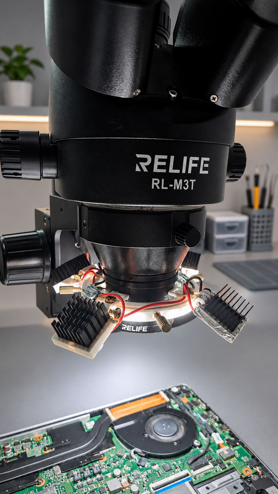
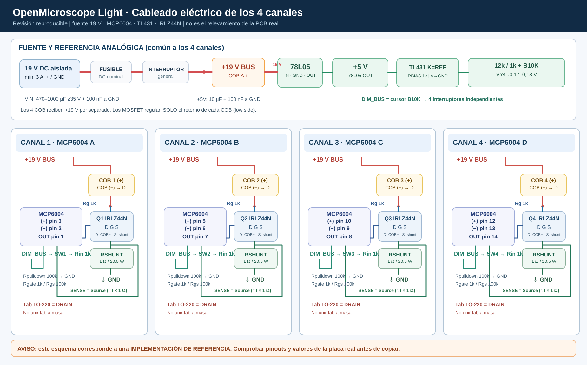

# OpenMicroscope Light — four-channel analog LED microscope lighting

[Español](README.md) · [Build guide](docs/BUILD_ES.md) · [Reference wiring](hardware/WIRING_ES.md) · [BOM](bom/BOM.csv)

  

Working prototype · click the image for full resolution

[Close-up of LED heads and heatsinks](docs/photos/prototype-closeup.jpg)

Source-available, non-commercial parametric microscope illuminator designed for electronics repair and microsoldering. It uses **four independently switchable COB LEDs** with analog current regulation (no intentionally applied LED PWM) and an articulated, 3D-printable four-pod head.

> **Copy and build, but do not sell without permission.** You can modify, reproduce and share covered design files for non-commercial purposes. Selling printed parts, kits, CAD files or assembled lights based on the current licensed materials requires separate written permission. Personally built lights may be used as tools in paid repair workshops. See [LICENSE](LICENSE) and [license transition](docs/LICENSE_TRANSITION.md); previous MIT grants are not retroactively revoked.

**Build status:** a PLA prototype was assembled on a **RELIFE RL-M3T** stereo microscope and has been used successfully for **over one month**. The original controller is functional on perfboard; the published wiring diagrams document the connections I followed when building my perfboard controller.

### Critical thermal warning
Measured COB heatsinks: **55–63 °C after over one hour at ~50% control setting**, and **~95 °C after ~10 minutes at 100%**. The initial PLA structure survived normal use but is **not validated for full-power continuous operation**. Aluminium tape is not a thermal insulator. Consider ABS/ASA/PC and improve heatsinking if full power is required; verify actual mechanical and thermal conditions.

### Electrical connection diagrams

[Full four-channel connection diagram](docs/diagrams/electrical-wiring-four-channels.svg) · [Individual channel and MCP6004 pinout](docs/diagrams/electrical-channel-and-pinout.svg) · [Written wiring guide](hardware/WIRING_EN.md)

These are the **circuit connections I followed to build my perfboard controller**.

### Rebuild in seven steps
1. Measure your microscope barrel/Barlow. The final V0.20 ring has **63 mm inner diameter, 83 mm outer diameter, 8 mm height** and three radial clamp screws.
2. Open [cad/current/microscope_led_head_v020.scad](cad/current/microscope_led_head_v020.scad) in OpenSCAD; set **part** to **ring**, **arm**, **pod**, or **print_plate** and export STL.
3. Print **1 ring + 4 arms + 4 pods** and check pivot and heatsink fit before making the full set.
4. Install four nominal **22 × 22 × 13 mm** aluminium heatsinks and four XIANGCLEAR 1311-5W COBs (seller advertises 6000K/Ra95; no independent spectral verification).
5. Build the [four-channel analog linear driver](hardware/WIRING_ES.md): MCP6004, four IRLZ44N MOSFETs, individual sense resistors, TL431, 78L05, B10K brightness control, four switches and ~19 V isolated DC supply. Start conservatively around **190 mA/channel**.
6. Verify supply, pinout, heatsink contact, MOSFET tab isolation, electrical current and thermal stability before normal use.
7. Align the four light sources (65°, 155°, 245°, 335° around the optical axis); switch individual emitters off to reveal solder joint detail.

**CAD archives:** [cad/history](cad/history/) and commit history. **Docs:** [build](docs/BUILD_ES.md), [electronics](hardware/WIRING_ES.md), [thermal tests](docs/THERMAL_TESTS.md), [CAD](docs/CAD_GUIDE.md).

Author: PC Service Computación / [facundodggileno](https://github.com/facundodggileno). new releases licensed under CC BY-NC-SA 4.0 for covered material; no commercial sale without separate permission. Prior MIT releases retain their licensing history. Experimental DIY project, without warranty. [License](LICENSE) · [Transition](docs/LICENSE_TRANSITION.md).

## Original-resolution development images

[Historical electrical connection concept — original PNG](docs/historical/historical-electrical-poster-original.png) (**superseded design; not a validated wiring schematic**). [Historical mechanical concept — original PNG](docs/historical/microscope-mechanical-concept-original.png). The installed microscope photograph is now uploaded at its original 900 × 1600 resolution.

## In-depth English documentation

- [Detailed build and assembly guide](docs/BUILD_EN.md)
- [Reference circuit and pin-by-pin wiring](hardware/WIRING_EN.md)
- [Measured thermal results and material limitations](docs/THERMAL_TESTS_EN.md)
