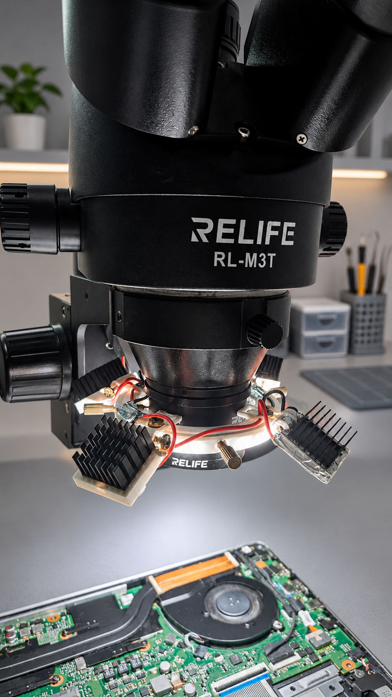

# OpenMicroscope Light

**Sistema de iluminación modular para microscopios de reparación electrónica: cuatro COB orientables, regulación analógica de corriente y piezas 3D paramétricas.**

[English](README.en.md) · [Construcción](docs/BUILD_ES.md) · [Electrónica](hardware/WIRING_ES.md) · [BOM](bom/BOM.csv) · [Historial](CHANGELOG.md)

[Detalle real de los módulos COB y disipadores](docs/photos/prototype-closeup.jpg)

**Estado:** prototipo funcional, construido e instalado en un **RELIFE RL-M3T** y utilizado de forma estable durante más de un mes. El controlador analógico se montó en placa perforada. **Versión final mecánica del autor: V0.20.**

> [!WARNING]
> **Límite térmico observado:** con la perilla a ~50%, después de más de una hora los disipadores midieron **55–63 °C**. Al 100%, llegaron a **~95 °C tras ~10 minutos**. La primera impresión fue en PLA con cinta de aluminio en zonas de apoyo, pero eso **no constituye aislamiento térmico ni validación de seguridad**. No se recomienda 100% continuo con esos disipadores. Para la versión definitiva se consideran ABS/ASA o policarbonato **y una evaluación térmica adicional**. Cambiar el plástico no enfría por sí solo la juntura del LED.

## Qué construimos

- Cuatro módulos COB **XIANGCLEAR 1311-5W** (~6000 K / Ra95 según vendedor, sin medición espectral independiente).
- Cuatro canales con **encendido individual** y ajuste compartido de brillo.
- Regulación de corriente **lineal sin PWM intencional**: MCP6004 + IRLZ44N + resistencias de sensado.
- Un aro sujeto con **tres tornillos radiales**, cuatro brazos y cuatro pods articulados con pivotes M3.
- Disipadores de aluminio nominales de **22 × 22 × 13 mm**; acceso por rieles deslizantes.
- Código fuente OpenSCAD histórico, guía, lista de materiales, diagramas y referencia eléctrica.

> La ausencia de PWM de control **no certifica flicker cero**: eso requeriría medir la luz con fotodiodo y osciloscopio. El esquema electrónico publicado es una **implementación de referencia reproducible**, no un netlist levantado directamente de la placa real del autor.

## Ensamble y geometría final

| Parámetro | V0.20 |
| --- | --- |
| Aro | Ø interior **63 mm**, Ø exterior **83 mm**, alto **8 mm** |
| Barlow del prototipo | aprox. Ø50 mm, sujeto por tres tornillos |
| Tornillos radiales | agujeros nominales Ø3,7 mm, ángulos 20° / 125° / 275° |
| Cuatro posiciones LED | 65° / 155° / 245° / 335°: **90° entre sí** |
| Articulación | M3, agujeros Ø3,3 mm |
| Tilt nominal | 25°, ajustable mediante pivote |
| Descenso del pod | 10 mm |
| Disipadores | 22 × 22 × 13 mm (medir los propios) |
| Cantidad de impresiones | **1 aro + 4 brazos + 4 pods** |

El archivo principal es **[cad/current/microscope_led_head_v020.scad](cad/current/microscope_led_head_v020.scad)**. La **[carpeta de revisiones](cad/history)** conserva los archivos desde la V0.6 y cada revisión está además reflejada en el historial de commits de este repositorio.

## Cómo reproducir

1. Medí el diámetro real del objetivo/Barlow y el espacio de trabajo de tu microscopio. En el prototipo se usó una distancia del Barlow a la PCB de aproximadamente **155 mm**.
2. Abrí [V0.20 en OpenSCAD](cad/current/microscope_led_head_v020.scad), adaptá el diámetro, holguras, tornillos y alojamiento del disipador. Elegí la variable **part**: **ring**, **arm**, **pod** o **print_plate**. Exportá cada STL (F6 → Export as STL).
3. Imprimí **1 aro, 4 brazos y 4 pods**. Proba primero un pod, sus guías y la articulación M3. Considerá ABS, ASA o PC adecuados a tu impresora para la pieza definitiva; no supongas que la temperatura del soporte es idéntica a la del disipador.
4. Prepará 4 COB y 4 disipadores con interfaz térmica adecuada; cableá los COB con alivio de tensión y sin interferir con los pivotes.
5. Construí y ensayá la [referencia electrónica de cuatro canales](hardware/WIRING_ES.md) con fuente de notebook aislada de alrededor de 19V. **Empezá con límite de corriente conservador (~190 mA por canal)**, no con la corriente máxima ensayada de ~340–350 mA.
6. Verificá alimentación, polaridad, corrientes, aislamiento del tab de los MOSFET y temperatura según la [puesta en marcha](docs/COMMISSIONING.md).
7. Ajustá los ángulos mirando una PCB real; apagá COB individuales para inspeccionar soldaduras y evitar reflejos especulares.

## Diagrama del sistema

~~~mermaid
flowchart LR
  PSU["Fuente aislada 19 V DC"] --> PROT["Protección + filtrado"]
  PROT --> COB["4 COB LED"]
  PROT --> REG["78L05, 5 V"]
  REG --> REF["TL431 + B10K"]
  REF --> SW["4 interruptores de canal"]
  SW --> OP["MCP6004: 4 lazos de corriente"]
  OP --> MOS["4 × IRLZ44N"]
  COB --> MOS
  MOS --> SHUNT["4 × 1 Ω shunt → GND"]
  SHUNT -. "realimentación" .-> OP
~~~

Diagramas editables: [arquitectura](docs/diagrams/system-architecture.mmd), [canal de corriente](docs/diagrams/channel-driver.mmd) y [dimming/referencia](docs/diagrams/reference-dimming.mmd).

## Documentación

- [Construcción mecánica e impresión](docs/BUILD_ES.md)
- [Cableado completo, pinout y límites eléctricos](hardware/WIRING_ES.md)
- [BOM con estados (montado / propuesto)](bom/BOM.csv)
- [Puesta en marcha y mediciones](docs/COMMISSIONING.md)
- [Ensayos térmicos y materiales](docs/THERMAL_TESTS.md)
- [Uso óptico: 4/3/2 fuentes y reflejos](docs/OPTICS_AND_USE.md)
- [Evolución del diseño y limitaciones](docs/HISTORY_ES.md)
- [Parámetros y exportación CAD](docs/CAD_GUIDE.md)
- [Fotografía real del montaje](docs/photos/prototype-installed-relife-rl-m3t.jpg) · [Fotografías y recursos originales](docs/photos/README.md)

**Autor del prototipo:** PC Service Computación / [facundodggileno](https://github.com/facundodggileno). Proyecto DIY experimental, sin garantía. **Licencia del contenido aquí publicado: MIT** (ver [LICENSE](LICENSE)).