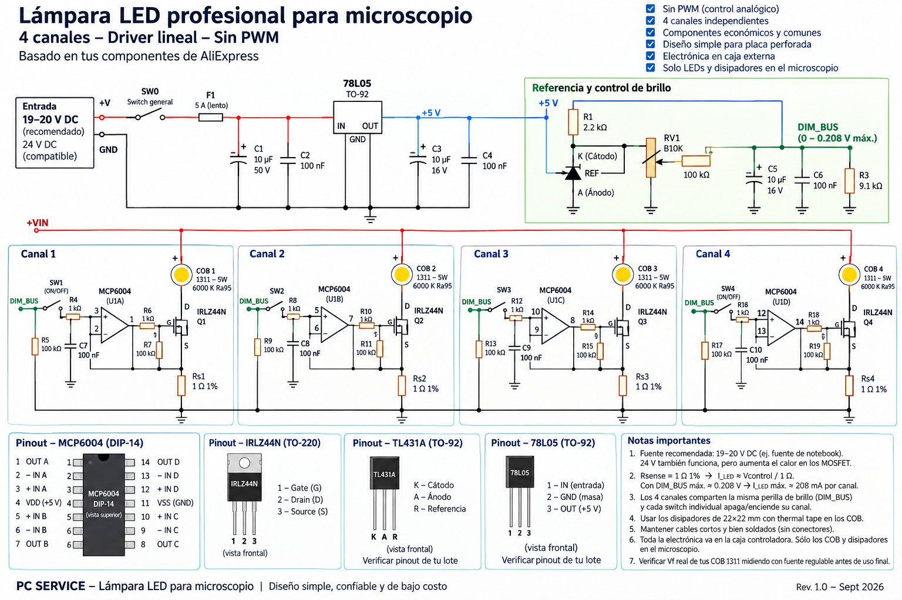
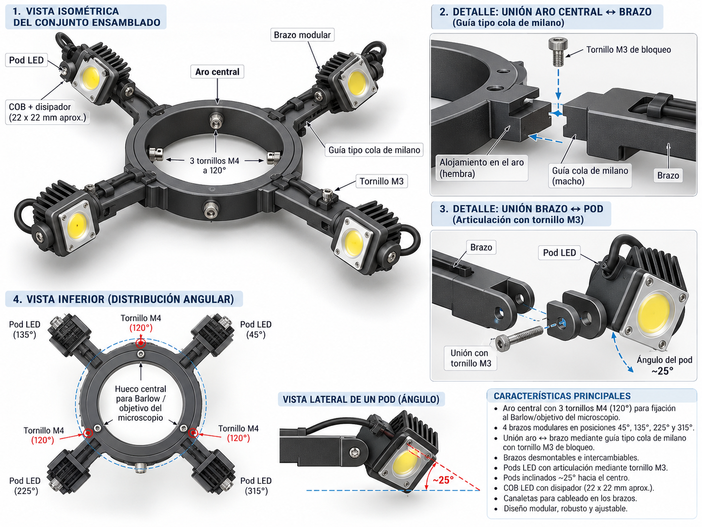

# Láminas originales del desarrollo

Estas imágenes se conservan **con sus dimensiones originales**, sin las miniaturas con pérdida utilizadas inicialmente.

## Propuesta histórica de conexiones eléctricas

**Importante:** representación de una etapa exploratoria; no es la implementación eléctrica de referencia actual ni un esquema relevado de la placa real. Para realizar el cableado utilizar los [diagramas actuales SVG](../diagrams/electrical-wiring-four-channels.svg) y [la guía de conexiones](../../hardware/WIRING_ES.md).

## Concepto mecánico original

El CAD definitivo está en [V0.20](../../cad/current/microscope_led_head_v020.scad). La imagen histórica no debe confundirse con las dimensiones finalmente construidas.
