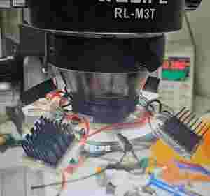

# Fotografías del prototipo

**Fotografías reales proporcionadas por el autor.** La imagen original del montaje tiene resolución de 900 × 1600 px. La versión actualmente publicada en GitHub está reducida; está pendiente sustituirla por el archivo original. Para imágenes de diagramas eléctricos en alta definición, consultar la sección de conexiones en el README o [los esquemas SVG](../diagrams/electrical-wiring-four-channels.svg), escalables sin pérdida. También se publica un render CAD generado automáticamente por GitHub Actions en **v020-assembly-preview.png**.

El prototipo en PLA tiene más de un mes de uso estable. Esto no invalida la advertencia sobre los 95 °C medidos al máximo.
