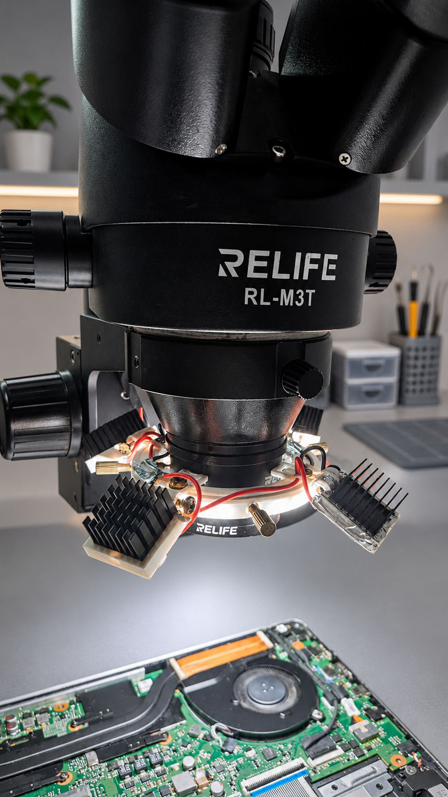

# Fotografías del prototipo

## Presentación con fondo ordenado

La imagen principal **ha sido editada para limpiar el fondo**. Es una fotografía de presentación del montaje real; la edición del entorno no modifica la documentación técnica. La versión publicada es una exportación JPEG de alta calidad de **941 × 1672 px** a partir de la imagen editada por el autor.

## Documentación adicional

[Vista del ensamblaje CAD V0.20](v020-assembly-preview.png) · [Diagramas de conexiones eléctricas](../diagrams/electrical-wiring-four-channels.svg)

Los modelos CAD, los STL y los ensayos térmicos deben consultarse en sus carpetas específicas; la imagen editada no sustituye las pruebas de fabricación.
