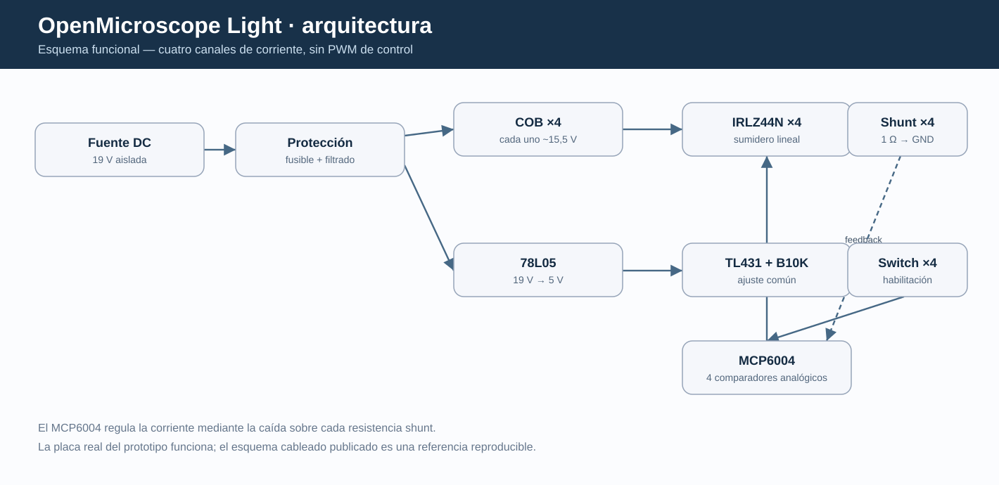
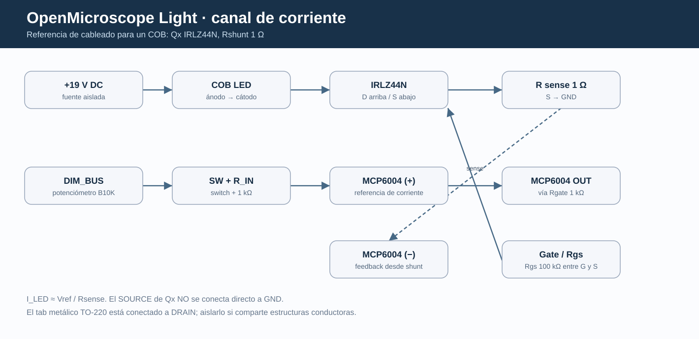
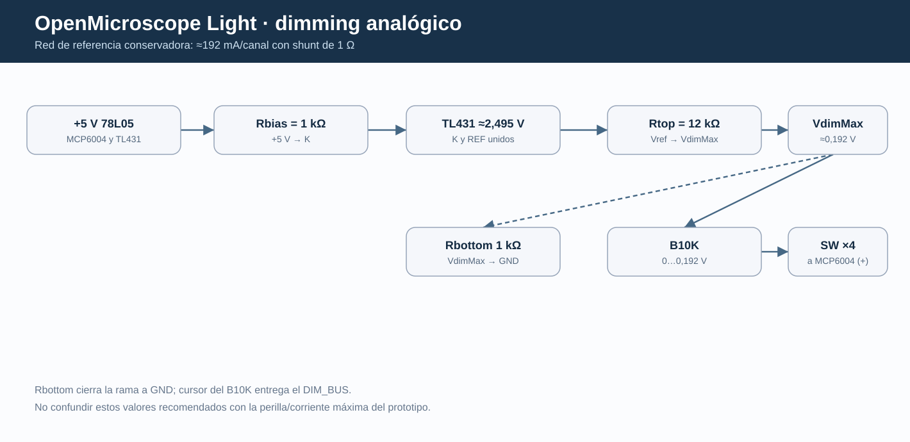

# OpenMicroscope Light — reproducible analog current driver

> **Scope:** I built my functional perfboard controller following the electrical diagrams published here. This guide documents those connections and includes conservative current-limit recommendations for anyone reproducing the build. Confirm every package pinout, limit current and test channels one at a time.

## Architecture

- External **isolated ~19 V DC supply, ≥3 A** with appropriate fuse/polarity checks.
- 78L05 creates **+5 V** for the MCP6004 and TL431 reference.
- One **MCP6004 PDIP-14** provides four independent control loops.
- Four **IRLZ44N TO-220** N-MOSFETs operate as linear, low-side current sinks.
- Four **1 Ω, 1%, ≥0.5 W** sense resistors, one per COB.
- One shared **B10K linear potentiometer** for brightness and four SPST switches for channel enable.
- No intentionally applied LED PWM. *Measured flicker-free output is not claimed* without photodiode/scope results.

## One low-side constant-current channel

~~~text
+19V ----------- LED COB anode -> COB cathode ------ IRLZ44N D
IRLZ44N S -------- R_SENSE 1 ohm -------- GND
MCP6004 OUT ------- R_GATE 1k ----------- IRLZ44N G
IRLZ44N G -------- R_GS 100k ----------- IRLZ44N S
DIM_BUS --- SWx --- R_IN 1k ------------ MCP6004 (+)
MCP6004 (+) ------ R_PULLDOWN 100k ----- GND
MCP6004 (+) ------ [optional 100 nF] --- GND
MCP6004 (-) ---------------------------- IRLZ44N S / top of sense resistor
~~~

**Do not short SOURCE directly to GND:** it must be above its own sense resistor. The IRLZ44N metal TO-220 tab is **DRAIN** and must not touch grounded metal without suitable electrical isolation. The opamp drives GATE to bring the sense voltage close to the positive-input control reference.

## MCP6004 PDIP-14 pin map

| Channel | Non-inverting (+) | Inverting (−) | OUT |
|---|---:|---:|---:|
| A | **3** | **2** | **1** |
| B | **5** | **6** | **7** |
| C | **10** | **9** | **8** |
| D | **12** | **13** | **14** |

**Pin 4 = +5 V (VDD); pin 11 = GND (VSS).** The physical package notch determines pin numbering. Verify manufacturer datasheets for MOSFET, TL431A and 78L05 lead order; markings alone cannot be relied upon.

## +5 V rail and conservative dimming reference

~~~text
+19 V -- correctly rated fuse -- power switch -- VIN
VIN -- 470–1000 µF / >=35 V (GND), 100 nF ceramic (GND)
VIN -- 78L05 IN ; 78L05 GND -- GND ; 78L05 OUT -- +5V
+5V -- 10 µF / >=16V and 100 nF ceramic -- GND

+5V -- 1 kΩ R_BIAS --> TL431 K
TL431 REF connected to TL431 K; TL431 A --> GND
TL431 K (~2.495V) -- 12 kΩ R_TOP -- V_DIM_MAX -- 1 kΩ R_BOTTOM -- GND
V_DIM_MAX --> B10K high end
B10K low end --> GND
B10K wiper --> DIM_BUS --> SW1..SW4 --> four channel input resistors
~~~

Using R_TOP=12k and R_BOTTOM=1k:

- **V_DIM_MAX ≈ 2.495 × 1/(12+1) = 0.192 V**.
- **I_LED ≈ V_DIM / R_SENSE** → approximately **192 mA/channel** with 1 Ω shunts, subject to actual component tolerances.
- R_BIAS current from ideal +5V is ~2.5 mA; resistor divider takes ~0.192 mA, leaving about 2.3 mA for TL431. Check against the actual device requirements.

The original prototype had experiments up to **~340–350 mA/channel**, which are **not recommended for continuous use** with the documented heatsinks (which reached ~95 °C at full control in around 10 minutes).

## MOSFET power

**P_Q ≈ (VIN − VF_COB − I × R_SENSE) × I.**

Illustrative example: VIN 19 V, COB forward voltage 15.5 V, I=0.35 A, R_SENSE=1 Ω → approximately **1.10 W dissipated per MOSFET**. The MOSFET needs adequate thermal management independently of the COB heatsink. Use suitable wiring cross section and clean sense-ground routing.

## Verification checklist

1. Check supply polarity, fuse, exposed connections and regulator pinouts **before powering on**.
2. Without COBs connected, measure +5 V, TL431 ~2.495 V, and a pot sweep from near 0 V to ~0.192 V.
3. Confirm each channel's non-inverting (+) input goes to ~0 V when its switch opens.
4. Test one COB on a current-limited supply; measure the 1 Ω shunt: **0.10 V → ~100 mA**, **0.19 V → ~190 mA**.
5. Confirm stable control and MOSFET/COB/heatsink/support temperatures, then test the other channels individually.
6. Recheck full assembly under typical work settings for 10/30/60 minutes. Avoid high-power continuous operation without a heatsink redesign.

Datasheets: [Microchip MCP6004](https://www.microchip.com/en-us/product/MCP6004) · [Infineon IRLZ44N](https://www.infineon.com/part/IRLZ44N) · [Texas Instruments TL431](https://www.ti.com/product/TL431).

Additional files: [reference netlist](reference-netlist.txt), [pin map CSV](pinout-reference.csv), [BOM](../bom/BOM.csv).