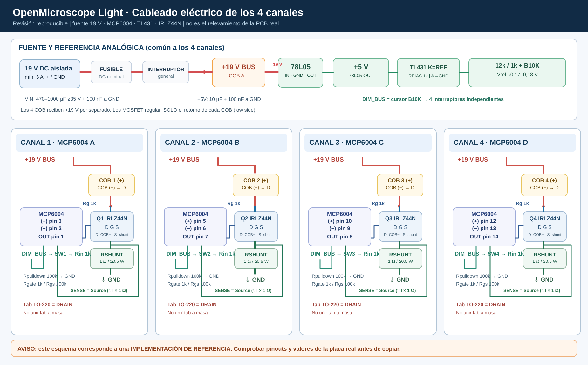
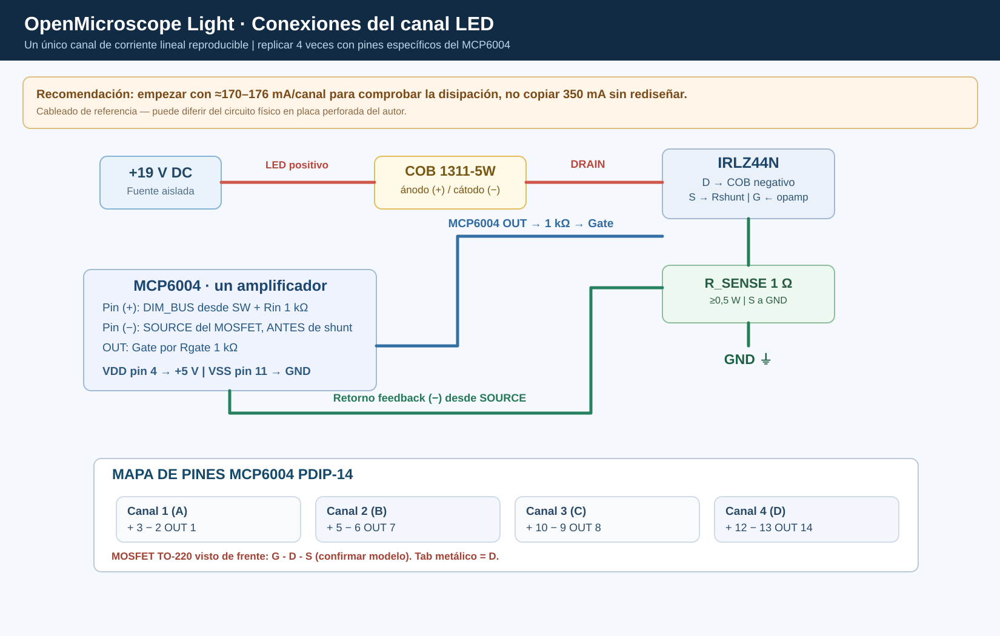
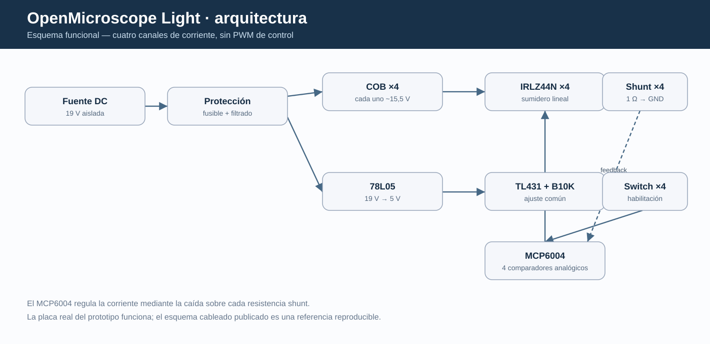
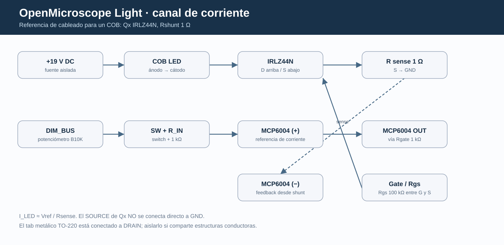
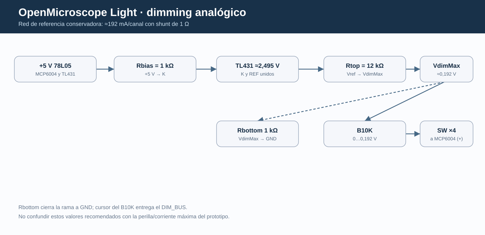

# Electrónica del prototipo — cuatro canales de corriente lineal

> **Alcance del documento:** construí mi placa de control perforada siguiendo los diagramas eléctricos publicados. En esta guía documento sus conexiones y agrego recomendaciones de verificación y límites de corriente conservadores para quienes quieran reproducirla. Medí y probá cada etapa antes de conectar los cuatro COB.

## Diagramas de conexiones reproducibles

La [lámina eléctrica histórica original](../docs/historical/historical-electrical-poster-original.png) está archivada por trazabilidad. **No utilizarla como plano definitivo**: el esquema de referencia detallado a continuación reemplaza sus valores exploratorios.

Estas láminas vectoriales se pueden ampliar sin perder nitidez. **Son esquemas funcionales de conexiones**, acompañados del pinout y los valores documentados abajo. Corresponden a las conexiones que utilicé en el controlador de mi prototipo.

## Arquitectura

- Fuente externa **aislada de aproximadamente 19 V DC / ≥3 A**, con protección de entrada y polaridad verificada.
- Fuente auxiliar **5 V** con **78L05** para MCP6004, TL431 y referencia de dimming.
- Un **MCP6004 (PDIP-14)** aporta cuatro amplificadores independientes.
- **Cuatro IRLZ44N** en modo lineal regulan corriente en los cuatro COB.
- Una resistencia **1 Ω / ≥0,5 W por canal** mide corriente.
- Un potenciómetro **B10K compartido** determina el ajuste y cuatro interruptores SPST habilitan cada canal por separado.
- No hay modulación PWM intencional. Ruido óptico del adaptador o la electrónica **no fue cuantificado** con fotodiodo.

Archivos fuente editables: [arquitectura](../docs/diagrams/system-architecture.mmd) · [canal](../docs/diagrams/channel-driver.mmd) · [referencia](../docs/diagrams/reference-dimming.mmd)

## Cableado de un canal

~~~text
+19 V -----> (+) COB (-) -----> D (IRLZ44N Qx)
                                 S -----> R_SENSE 1 Ω -----> GND
                                 G <----- R_GATE 1 kΩ <----- MCP6004 OUT
G ------------------ R_GS 100 kΩ -------- S
MCP6004 (+) <------ R_IN 1 kΩ <---------- SWx <---- DIM_BUS
MCP6004 (+) ------ R_PULLDOWN 100 kΩ ---> GND
MCP6004 (+) ------ [100 nF opcional] ---> GND
MCP6004 (-) ----------------------------> S / extremo superior de R_SENSE
~~~

**El SOURCE no va directo a masa:** la resistencia shunt está entre SOURCE y GND. La pestaña metálica TO-220 del IRLZ44N es **DRAIN**, no masa; debe mantenerse aislada de otras superficies eléctricamente conductoras, o usar aislante homologado.

## MCP6004, encapsulado PDIP-14

| Canal | + no inversora | − inversora | OUT | Sensado |
|---|---:|---:|---:|---|
| A | **3** | **2** | **1** | S1 / Rshunt1 |
| B | **5** | **6** | **7** | S2 / Rshunt2 |
| C | **10** | **9** | **8** | S3 / Rshunt3 |
| D | **12** | **13** | **14** | S4 / Rshunt4 |

**Pin 4 = VDD (+5 V)** y **pin 11 = VSS (GND)**. Verificá la orientación de la muesca en el encapsulado antes de soldar.

## Límite de corriente conservador recomendado para reproducirlo: ~190 mA

~~~text
+19 V -> fusible adecuado -> interruptor general -> VIN
VIN -> 470–1000 µF / >=35 V (a GND); 100 nF cerámico (a GND)
VIN -> IN 78L05; GND 78L05 -> GND; OUT -> +5V
+5V -> 10 µF / >=16V + 100 nF cerámico -> GND

+5V -> R_BIAS 1 kΩ -> K TL431
A TL431 -> GND
REF TL431 unido a K -> salida nominal ~2,495 V
K -> R_TOP 12 kΩ -> V_DIM_MAX -> R_BOTTOM 1 kΩ -> GND
V_DIM_MAX -> extremo alto POT B10K
GND -> extremo bajo POT B10K
POT cursor -> DIM_BUS -> 4 interruptores individuales
~~~

Con R_TOP=12 kΩ y R_BOTTOM=1 kΩ:

**V_DIM_MAX ≈ 2,495 V × (1/13) ≈ 0,192 V**.

**I_LED ≈ V_DIM / R_SENSE**, así que con R_SENSE=1 Ω el máximo inicial es aproximadamente **192 mA por COB**, sujeto a tolerancias. El divisor consume alrededor de **0,192 mA** y R_BIAS aporta idealmente **2,5 mA** desde +5 V, dejando unos **2,3 mA** para la referencia TL431; confirmar condiciones de funcionamiento de la variante concreta.

> El prototipo ensayó aproximadamente **340–350 mA por COB** a máximo ajuste. No copiar ese límite al construir una unidad con los mismos disipadores: se midieron **~95 °C en 10 minutos** al máximo. Un posible R_TOP=6,2 kΩ con R_BOTTOM=1 kΩ daría ~347 mA teóricos; se menciona como **cálculo**, no como instrucción de montaje.

## Componentes por cada canal

| Ref. | Cantidad | Valor / función |
|---|---:|---|
| COB | 1 | XIANGCLEAR 1311-5W (6.000 K / Ra95 según vendedor) |
| Qx | 1 | IRLZ44N / IRLZ44NPBF N-MOSFET TO-220 |
| R_SENSE | 1 | **1 Ω, 1 %, ≥0,5 W** |
| R_GATE | 1 | **1 kΩ**, salida opamp a G |
| R_GS | 1 | **100 kΩ**, G a S |
| R_IN | 1 | **1 kΩ**, SW a opamp (+) |
| R_PULLDOWN | 1 | **100 kΩ**, opamp (+) a GND |
| C_IN | opcional | 100 nF, opamp (+) a GND |
| SW | 1 | SPST en la señal de referencia, no en la ruta de alta corriente |

El opamp compara la referencia con la tensión shunt y ajusta el MOSFET para igualarlas. La realimentación y la masa de sensado no deben atravesar cables comunes por donde circula una gran corriente, si se puede evitar: se recomiendan retornos tipo estrella / Kelvin.

## Disipación térmica del MOSFET

**P_MOSFET ≈ [VIN − V_COB − (I × R_SENSE)] × I**.

A modo de ejemplo, con VIN=19 V, V_COB=15,5 V, I=0,35 A y R=1 Ω, cada MOSFET disipa ~**1,10 W**. Incluso un canal que funciona correctamente puede sobrecalentar su transistor si no se disipa ese calor.

También se disipa potencia en cada COB y en el regulador de 5 V. Las corrientes, Vf y temperaturas reales dependen de la unidad, la temperatura y el montaje.

## Checklist antes de alimentar los LEDs

1. Confirmar polaridad y tensión nominal de la fuente, cableado, fusible y ausencia de cortos.
2. Sin LEDs conectados, verificar **+5 V**, referencia TL431 **~2,495 V** y cursor pot **0–0,192 V** (para la referencia conservadora).
3. Con interruptor de canal abierto, confirmar que la entrada no inversora quede a aproximadamente 0 V.
4. Verificar pinout real de **TL431 y 78L05** con el datasheet de la **marca y encapsulado utilizados**; puede variar.
5. Conectar un único COB a baja corriente y verificar Vshunt. **0,100 V = ~100 mA**, **0,190 V = ~190 mA**, con 1 Ω.
6. Medir temperaturas en MOSFET, disipador del COB y soportes, primero tras pocos minutos y luego con ensayos más largos.
7. Agregar los otros canales uno por vez; no asumir que corrientes y temperaturas son idénticas.

Datasheets: [MCP6004 Microchip](https://www.microchip.com/en-us/product/MCP6004) · [IRLZ44N Infineon](https://www.infineon.com/part/IRLZ44N) · [TL431 Texas Instruments](https://www.ti.com/product/TL431).

Para la descripción térmica del prototipo: [THERMAL_TESTS](../docs/THERMAL_TESTS.md).